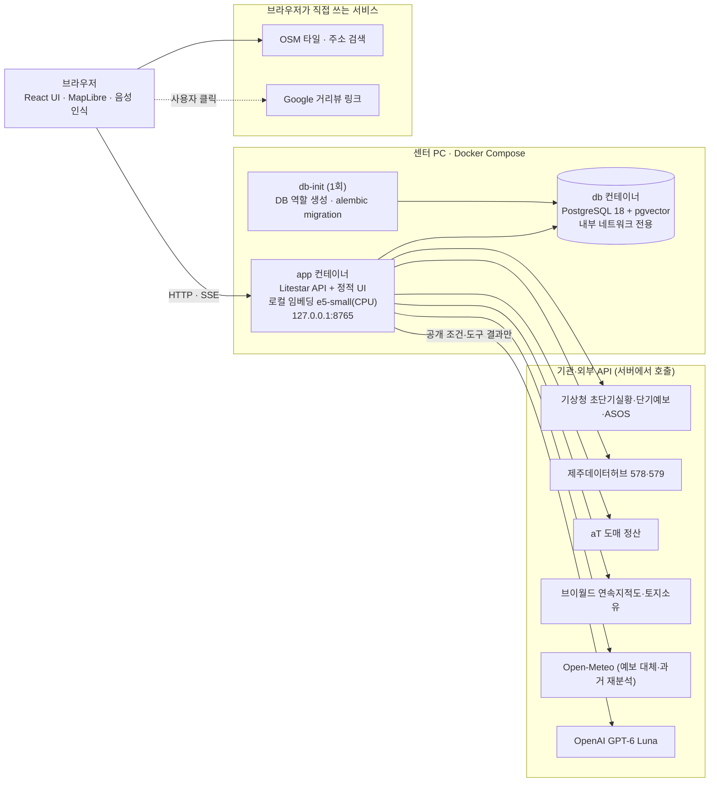
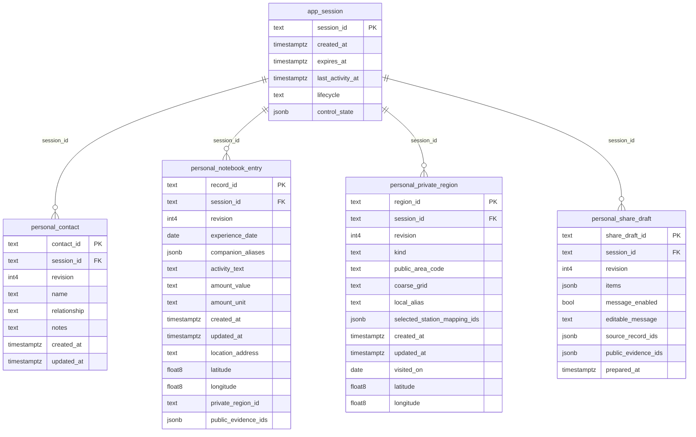
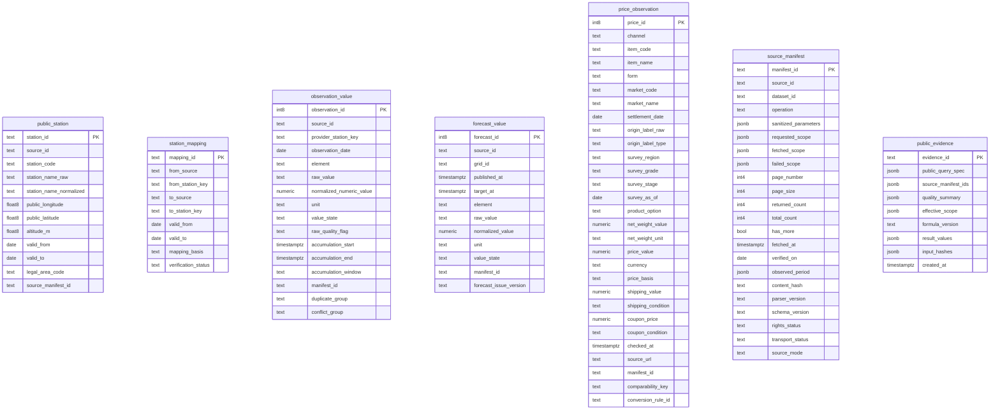
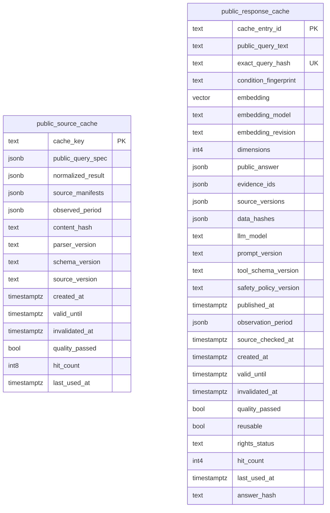

# 서버 구성과 데이터 구조

## 서버 구성

센터 PC 한 대에서 Docker Compose로 컨테이너 2개를 띄운다. 브라우저는 `127.0.0.1:8765` 한 곳만 접속한다.

- app 컨테이너는 읽기 전용 루트, 비root 사용자, 외부 포트는 8765 하나다. 설정은 `apps/api/.env`에서 읽는다.
- db 컨테이너는 호스트에 포트를 열지 않는다. 네이티브 개발 때만 `compose.native.yaml`로 `127.0.0.1:15432`를 연다.
- 개인 기록 원문은 OpenAI에 보내지 않는다. 모델에는 공개 조건, 도구 결과, 개인 검색의 종류·건수만 간다.
- 기획서의 시스템 구성도: [제주고사리_시스템구조도_v0.21.svg](proposal/assets/제주고사리_시스템구조도_v0.21.svg)

실행 흐름과 캐시 규칙은 [에이전트 실행·캐시 구조](agent-runtime.md), 설정값은 [설치·운영 매뉴얼](install-manual.md)에 있다.

## ERD

테이블 14개가 한 DB에 있다. 개인 기록 4개 테이블은 `app_session`을 외래 키로 참조하며 세션이 끝나면 함께 지운다. 공개 자료 테이블은 외래 키 없이 `station_id`·`source_id`·`evidence_id` 문자열로 느슨하게 연결한다. 응답 캐시의 `embedding`은 pgvector 384차원이며 현재는 순차 탐색이고 벡터 인덱스는 만들지 않았다.

### 세션과 개인 기록

### 공개 자료와 근거

### 캐시

| 테이블 | 역할 |
| --- | --- |
| app_session | 브라우저 세션. 개인 기록의 소유 단위이며 기본 365일 보관 |
| personal_notebook_entry | 내 수첩 채취 기록(위치·참고 자료 포함) |
| personal_private_region | 관심 장소 핀·방문일·메모 |
| personal_contact | 지인 관계 |
| personal_share_draft | 나눔 기록과 공유 파일 초안 |
| public_station | 공개 관측 지점 카탈로그 |
| station_mapping | 지역 이름과 관측 지점의 연결 |
| observation_value | 관측값(일자료·실황) 정규화 행 |
| forecast_value | 단기예보 정규화 행 |
| price_observation | 가격 정규화 행(소매·조사가·도매) |
| source_manifest | 원천별 취득 시각·버전·쿼터 기록 |
| public_evidence | 조회 결과의 근거(원문 링크·해시·시점) |
| public_source_cache | 기관 조회 결과 캐시(조건 해시 단위) |
| public_response_cache | 대화 응답 캐시. exact 해시와 의미 벡터를 한 행에 저장 |
