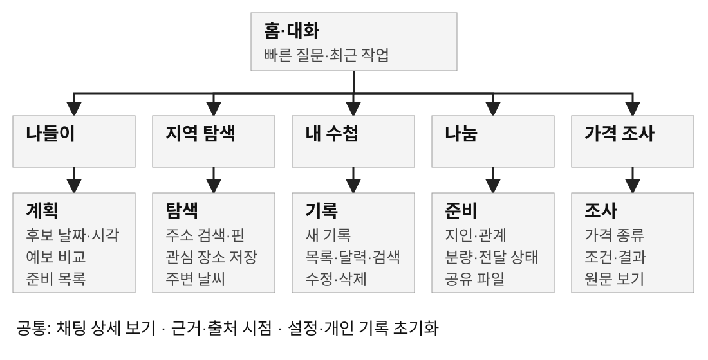
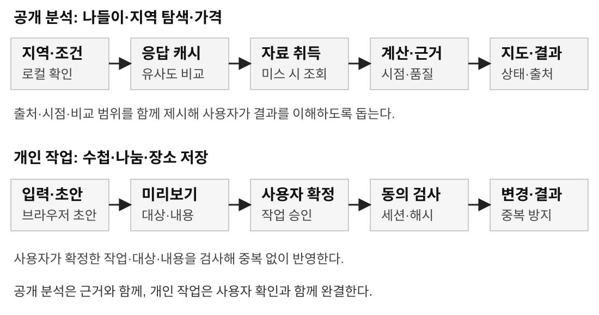
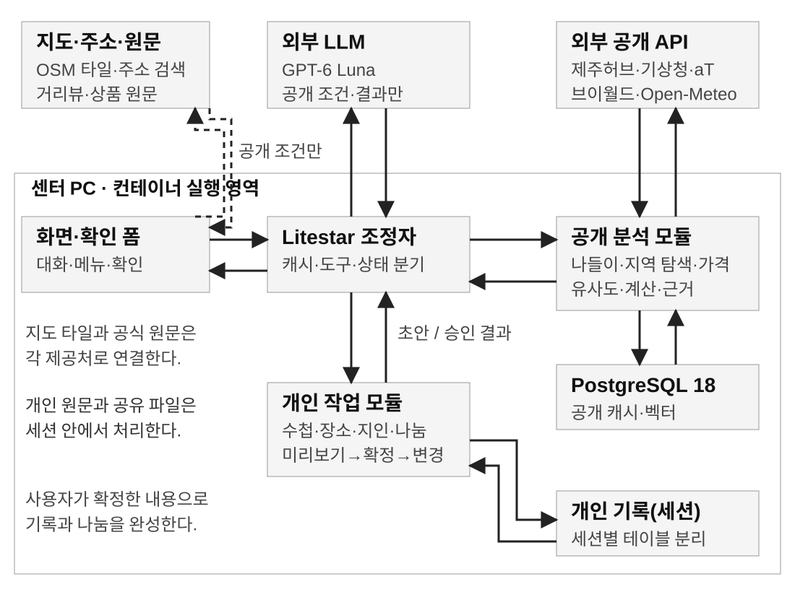

# 고사리잇

제주 고사리 채취 동행 AI 에이전트 개발 기획서

신은광 · 2026. 11.

## 목차

1. 구현목표
2. 서비스 제안
3. Agent 개발 구성
4. 데이터 활용 계획
5. 개발·탑재 계획

레퍼런스

## Ⅰ. 구현목표

### 1. 분석 주제

제주에서는 봄 고사리철이 되면 어르신들이 가족이나 이웃과 삼삼오오 모여 한라산 주변의 중산간으로 고사리 나들이를 간다. 직접 꺾은 고사리는 집에서 먹거나 가족·지인들과 나누고, 삶아서 제주 바람과 햇살에 말려 보관하거나 판매하기도 한다.

고사리잇은 이런 고사리철의 생활을 돕는 AI 에이전트다. 자주 가는 지역과 새 관심 지역의 날씨를 비교하고, 나들이 준비부터 경험 기록, 가족·지인 나눔, 가격 정보 확인까지 하나로 연결한다.

- 서비스명은 고사리잇으로 하며, 주요 이용자는 취미로 고사리를 캐는 제주도민과 가족·이웃 모임으로 설정한다.
- 분석 대상은 지역별·기간별 관측, 후보 시간의 예보, 가격 종류별 자료이며, 개인의 경험 기록은 별도 자료로 연결한다.

### 2. AI를 활용한 데이터 분석 목표

| 분석 목표 | AI 및 분석 도구의 역할 | 제공 결과 |
| --- | --- | --- |
| 질문을 분석 조건으로 구체화 | 기간·관측소·후보 시간·품목·가격 종류를 정리하고 필요한 조건을 질문 | 확인된 분석 조건과 실행 계획 |
| 비교 가능한 자료 구성 | 지점·기간·단위·규격·자료 품질을 검사하고 공통 비교 범위를 산출 | 관측·예보·가격 비교표 |
| 분석 결과 해석 지원 | 검증된 수치와 출처·발표시각을 바탕으로 차이와 선택 이유 설명 | 출처·시점·범위가 포함된 결과 |
| 생활 작업으로 연결 | 분석 결과를 기록·준비 목록·나눔 기록으로 재사용 | 수첩·준비 목록·나눔 공유 파일 |

자연어 이해와 계획·설명은 대규모 언어 모델(LLM)이 담당하고, 자료 검사·집계·비교·개인 변경 처리는 결정론적 도구와 확인 폼으로 구현한다.

## Ⅱ. 서비스 제안

### 1. 데이터 활용 개요

제주데이터허브의 기상관측소 정보와 일별 기상 정보를 핵심 자료로 사용한다. 기상청 실황·단기예보는 현재 맥락과 후보 일정의 조건을 보완하고, 가격은 도매·지역 조사가·상품 표시가로 구분한다.

| 자료 구분 | 활용 내용 | 연결 기능 |
| --- | --- | --- |
| 제주데이터허브 지역 관측 | 지역별 관측소 탐색, 기간·항목별 비교와 자료 품질 정리 | 지역 탐색·비교, 나들이·수첩 |
| 기상청 실황·단기예보 | 현재 격자 실황과 후보 시간의 단기예보 비교(발표시각 표시) | 나들이, 채팅 |
| Open-Meteo | 지도 날씨, 최근 3·7일 강수·기온 맥락, 단기예보 범위 밖의 대체 예보 | 나들이, 지역 탐색 |
| 가격 자료 | 시장·조사지역·원산지 표시·규격·배송 조건 비교, 1kg 환산 | 가격 조사 |
| 토지 소유·거리뷰 | 선택한 공개 지점의 필지 소유 구분과 같은 좌표의 거리뷰 링크 | 채팅 상세 |
| 개인 입력 | 날짜·동행 별칭·활동·위치·지인별 나눌 양과 전달 상태 | 내 수첩, 나눔 |
| OSM 기반 지도 | 주소 검색·관심 장소 핀·주변 날씨, 공개 관측소 표시 | 지역 탐색 |

### 2. 핵심 기능

| 기능 | 처리 내용 | 주요 결과 |
| --- | --- | --- |
| 나들이 동행 | 후보 날짜·지역·시각과 기상 선호를 확인하고 기상청 단기예보로 비교. 범위 밖은 Open-Meteo로 대체 | 후보별 조건·출처·발표시각·선택 이유·준비 목록 |
| 지역 탐색 | 주소 검색·지도 핀으로 관심 장소를 저장하고 방문일·메모·주변 날씨를 확인 | 관심 장소 목록·지역별 관측 비교표 |
| 내 수첩 | 경험을 확인 폼으로 정리하고 목록·달력·검색으로 활용 | 개인 기록·회고 |
| 가족·지인 나눔 | 지인 관계와 사람별 나눔 이력을 날짜·분량·단위·예정/전달 완료로 정리 | 대상별 나눔 이력·공유 파일(승인 후 내려받기) |
| 가격 조사 | 도매·조사·소매 자료를 질문에 맞게 분기하고 상품/1kg 기준으로 환산 | 조건별 가격 카드·공식 원문 |

사용자가 채팅에서 날씨·지역·가격을 물으면 모델이 도구를 고르고 서버가 실제 자료를 조회한다. 결과는 상세 보기에서 지도·표로 확인하며, 관심 장소·수첩·나눔 기록으로 이어진다.

예를 들어 “어머니께 한 봉지, 이웃에게 두 봉지 나눌게”라고 하면 대상과 분량을 확인해 나눔 기록을 만들고, 필요하면 지인별 기록을 파일로 내려받아 전달한다.

### 3. 편의성

사용자 유형에 따라 입력 부담과 자료 해석의 차이를 고려한다. 짧은 문장·선택형 입력·비교표·저장 전 확인을 공통 화면 원칙으로 적용한다.

| 구분 | 정희, 58세 여성 | 민수, 33세 | 수진, 44세 |
| --- | --- | --- | --- |
| 상황 | 제주 거주. 취미로 고사리를 캐고 가족·지인과 나누려 한다. | 제주 거주 직장인. 가족이 함께 갈 주말 시간을 정한다. | 소모임 구매 담당. 필요한 제주산 고사리의 형태·규격·조건을 비교한다. |
| 목표 | 지난 봄의 경험을 찾고, 가족·지인에게 줄 고사리의 분량을 정리한다. | 후보 시간의 예보를 비교하고 가족에게 준비 계획을 설명한다. | 생·건, 중량, 배송비와 가격 종류를 구분해 참고 자료를 고른다. |
| 해결할 불편 | 사진·메신저에 남은 기록을 날짜별로 다시 모으기 번거롭다. | 여러 앱에서 일정·예보·지난 기록을 오가야 한다. | 도매·조사·소매 숫자와 원산지 표시의 의미가 서로 다르다. |
| 화면 원칙 | 짧은 문장·선택형 입력, 큰 주요 버튼, 저장 전 확인, 쉬운 되돌리기. | 후보별 비교 카드, 출처·발표시각 표시, 준비 목록 재사용. | 가격 종류를 먼저 선택하고 옵션·원산지·배송·확인일을 같은 카드에 표시. |

- 정희는 경험 찾기·기록·회고에서 나눔 기록까지 이어지는 흐름을 사용한다.
- 민수는 후보 시간과 예보를 비교하고 가족의 준비 목록을 완성한다.
- 수진은 가격 종류·규격·배송 조건을 확인하고 필요한 판매처 원문을 찾는다.

본문 16px 이상과 주요 조작 44px 이상을 UI 설계 목표로 두고, 키보드·마우스·선택형 입력과 브라우저 음성 입력을 함께 지원한다.

정보구조(IA)는 홈·대화를 공통 진입으로 두고 나들이·지역 탐색·내 수첩·나눔·가격 조사의 다섯 메뉴와 하위 화면으로 구성한다.

| 사용자 | 대표 이동 경로 |
| --- | --- |
| 정희, 58세 여성 | 채팅에서 지난 기록 검색 → 수첩 작성 → 지인 나눔 기록 → 공유 파일 |
| 민수, 33세 | 지도에서 관심 지역 비교 → 후보 시간·예보 확인 → 준비 목록 |
| 수진, 44세 | 가격 종류 → 조건별 결과 → 원산지·배송·판매처 원문 → 1kg 환산 비교 |

지도에 관심 장소 핀과 제주데이터허브 관측소를 구분해 표시한다. 같은 기간·항목의 수치는 비교표와 함께 보여 주며, 장소 저장은 사용자가 확인한다.

### 4. 분석데이터 활용 방안

OpenStreetMap 기반 지도에서 기존 이용 지역과 새 관심 지역을 선택한다. 제주데이터허브 관측소·공통 기간을 확인해 지역별 관측을 비교하고, 현재 실황과 후보 시간 예보를 별도 표시한다.

| 활용 사례 | 사전 검증 내용 | 서비스 적용 |
| --- | --- | --- |
| 과거 봄 비교 | 선흘 2023·2024년 4~5월 122일 검증. 공통 4/11~5/31의 51일에서 강수 >0은 각각 21/51일·20/51일 | 같은 지점·공통 기간·분모를 표시한 연도 비교. 지역별 비교도 동일 품질·기간 기준 적용 |
| 최근 봄 관측 | 제주184의 2026년 4~5월 공개 표 61일 확보. 강수 양수 24일·숫자 0 8일·공란 29일 | 기록일 관측 맥락과 항목별 품질을 표시 |
| 당일 관측 | 2026-11-05 18:43 KST 제주 43지점 공개 표 확인. 제주184 16.5℃·일강수 5mm | 관측시각과 지점을 표시한 현재 맥락 |
| 후보 시간 예보 | 2026-11-08 단기예보 실호출 835행 확인. 제주시 09시·서귀포 15시 후보가 11시 발표분으로 비교됨 | 발표시각·대상시각을 카드에 표시하고 범위 밖은 대체 출처를 경고로 표시 |

| 가격 자료 | 사전 조사 예시 | 적용 방식 |
| --- | --- | --- |
| 도매 경락·정산 | aT 33시장 표본: 2026-04-21 181행·2026-05-12 126행. 제주 산지명 0건 | 거래일·시장·산지·생/건·단량별 탐색 |
| 지역 조사가 | 2026-11-04 제주 생고사리 상: 생산지 11,500·도매지 15,000·소비지 18,500원/kg | 조사지역·등급·유통단계별 조회 |
| 상품 표시가 | 탐나오 서귀포산 건고사리 100g 17,000원·200g 32,500원, 배송 4,000원 | 원산지 표시·옵션·배송·확인시점 제공, 1kg 환산 |

## Ⅲ. Agent 개발 구성

### 1. 참여자의 역할·목표·Workflow

| 구분 | 내용 |
| --- | --- |
| 참여자·역할 | 신은광(개인 참가): 기획, 데이터 연계, Agent·UI 구현, 테스트, 설치·패키징 및 최종 확인 |
| 개발 목표 | 다섯 기능을 하나의 대화와 작업 상태로 연결하고, 출처·비교 조건·개인 변경의 확인 절차를 일관되게 구현 |
| AI 보조 역할 | 질문 구조화, 허용 도구 선택, 공개 분석 결과 설명. 계산·품질 검사·개인 변경은 코드와 확인 폼으로 처리 |

공개 질문은 지역·기간·자료 시점을 확인한 뒤 같은 질문·유사 질문의 응답 캐시를 먼저 찾는다. 캐시가 없으면 공개 자료를 조회하고 GPT가 결과를 설명한다. 개인 기록은 캐시에 넣지 않고 세션 안에서 확인 후 처리한다.

### 2. 사용 모델

| 항목 | 구성 |
| --- | --- |
| 사용 모델 | OpenAI GPT-6 Luna (gpt-6-luna), 로컬 임베딩 multilingual-e5-small(리비전 고정) |
| 모델 역할 | GPT는 공개 질문·도구 선택·설명, 로컬 임베딩은 질문 간 코사인 유사도 비교(0.95 초과만 재사용) |

### 3. Tool/API

| 기능 | 내부 Tool | API·입력 | 결과 |
| --- | --- | --- | --- |
| 나들이 | current_observation / forecast_compare / outing_compare | 기상청 초단기실황·단기예보 getVilageFcst, Open-Meteo 대체·최근 맥락 | 현재 실황, 발표시각별 예보, 후보 순위·이유·준비 목록 |
| 지역 탐색 | station_search / history_compare / region_compare | 제주데이터허브 578·579, 선택 관측소·기간 | 관측소 후보, 연도·지역별 관측 비교와 근거 |
| 지점 정보 | land_ownership / open_street_view | 브이월드 연속지적도·토지소유정보, Google Maps URL | 공식 소유 구분·기준월, 거리뷰 링크 |
| 응답 캐시 | exact·semantic 응답 캐시(서버 내부) | 공개 질문 해시·조건·임베딩 | 같은 조건의 유사 질문에 기존 답 재사용 |
| 개인 검색·폼 | search_personal_records / open_personal_form | 세션 내 수첩·관심 장소·지인·나눔 | 종류·건수만 모델에 전달, 작성 폼 열기 |
| 수첩·장소·지인·나눔 | 개인 API: prepare → consent → commit | 미리보기 해시·사용자 동의 | 저장·수정·삭제·공유 파일 |
| 회원 | 계정 API: signup / login / logout | 아이디·비밀번호(Argon2id 해시) | 익명 세션 기록을 회원 세션으로 병합, 기기 간 동일 기록 |
| 가격 조사 | market_query / survey_link / retail_lookup | aT 코드·정산, 산림조합 원문, 판매 표본 | 채널별 조건·가격·1kg 환산·원문 |

### 4. 판단 및 자율 수행 범위

| 구분 | Agent 수행 내용 | 사용자 확인 |
| --- | --- | --- |
| 질문·조건 | 의도와 필요한 기간·지점·가격 종류를 정리하고 모호한 조건을 질문 | 분석할 조건 확정 |
| 공개 자료 | 지역·기간·시점과 유사도를 확인해 답변 재사용, 또는 출처 조회·검사·집계 | 질문 범위를 벗어나는 추가 분석 |
| 나들이 비교 | 실황·예보·개인 선호를 구분한 후보 비교와 준비 목록 작성 | 후보 일정과 선호 선택 |
| 장소 저장 | 주소·핀을 관심 장소로 정리하고 저장 미리보기 제공 | 저장할 장소와 별칭 확정 |
| 개인 기록 | 수첩·관심 장소·지인·나눔의 미리보기 | 저장·수정·삭제·공유 파일의 대상·내용 확정 |
| 결과 활용 | 출처·시점·범위와 다음 행동 안내 | 개인 기록 연결·공유 파일 내려받기 선택 |

- 공개 분석은 허용된 입력 형식과 도구 목록으로 실행하며, 코드가 자료 품질과 계산 범위를 검사한다.
- 계획 최대 8단계·재시도 최대 3회·작업당 64,000토큰을 기본으로 두고 조회·시간·비용 예산을 설정한다.
- 사용자가 확정한 작업·대상·내용과 실제 반영을 일치시키고 동일 요청의 중복 변경을 방지한다.

판단 대상은 관측·예보·가격의 비교와 생활 준비로 설정한다.

자료의 범위가 부족하면 확인할 조건과 다른 공식 경로를 안내한다. 개인 원문은 세션 영역에서만 처리하고 공개 분석의 모델 입력과 분리한다.

## Ⅳ. 데이터 활용 계획

### 1. 필수 데이터명·출처·활용 항목

| 구분·데이터명 | 출처 | 활용 항목·용도 |
| --- | --- | --- |
| 필수: 기상관측소 정보(API 578) | 제주데이터허브 | 관측소 코드·명칭, 운영기간, 위치·고도. 기존 지역과 새 관심 지역의 관측소 후보 확인 |
| 필수: 일별 기상 정보(API 579) | 제주데이터허브 | 기준일·관측소명·일강수량·평균기온. 지역별·연도별 공통 기간 비교 |
| 보완: ASOS 일자료 | 기상청 / 공공데이터포털 15059093 | 지점·일자·기온·강수·품질정보. 최근 시계열과 기록일의 맥락 |
| 보완: 초단기실황·단기예보 | 기상청 / 공공데이터포털 15084084 | 격자 실황, 발표·대상시각별 기온·강수확률·풍속·강수 범주. 현재 맥락·후보 비교 |
| 보완: Open-Meteo | open-meteo.com | 지도 날씨, 최근 강수·기온 맥락, 단기예보 범위 밖 대체 예보. 출처를 구분 표시 |
| 보완: 표준코드·도매 정산 | aT / 공공데이터포털 15141818·15141809 | 품목·산지·시장·거래일·단량·등급·포장·가격 |
| 보완: 지역 조사가·상품 표시가 | 산림조합 forestinfo / 탐나오 등 공식 판매처 | 조사지역·등급·유통단계 또는 원산지 표시·중량·배송·쿠폰 |
| 보완: 토지 소유 구분 | 브이월드 연속지적도·토지소유정보 | 좌표가 포함된 필지 PNU, 공식 소유 구분·기준월 |
| 보완: 지도·주소 | OpenStreetMap 타일, Nominatim·Daum 주소 검색 | 배경 지도·주소 검색·좌표 변환. 관심 장소와 관측소 위치 표시 |

제주데이터허브 자료는 지역 지점 탐색과 과거 봄 비교의 핵심으로 사용한다. 수첩·나눔은 사용자의 기록과 입력을 처리하고, 선택한 공개 분석 결과를 활용하는 생활 기능으로 구성한다.

### 2. 수집·전처리 방법

- 제주데이터허브 578은 관측소 조건으로, 579는 날짜별로 요청한다. 페이지 수·실제 반환 수·전체 건수·추가 페이지 여부를 대조한다.
- 원 응답·정규화 자료·조회 조건·수집일·출처·행수·해시·처리 버전을 구분해 보존한다.
- 관측소 코드·명칭·운영기간·위치 이력을 확인한다. 같은 원천의 여러 제공경로를 중복 관측으로 집계하지 않는다.
- 원 필드와 품질표시를 유지하고 숫자 0·결측·오류·의미 미확정 공란을 구분한다. 같은 키의 동일 중복은 1회 집계하고 충돌은 확인 대상으로 처리한다.
- 단기예보는 발표시각과 대상시각을 함께 보존하고, ‘1mm 미만’처럼 구간으로 제공되는 강수는 수치로 바꾸지 않는다.
- 항목별 유효 범위와 공통 날짜를 계산한다. 가격은 종류·생/건·산지·단량·등급·배송·쿠폰 조건을 나눠 비교한다.
- 캐시도 출처·조건·시점·해시·처리 버전을 확인한 뒤 품질 검사와 계산을 수행한다.

### 3. 이용조건

| 자료 | 적용 원칙 |
| --- | --- |
| 제주데이터허브 공개 API | 직접 호출하고, API 공개 CSV를 대회 제출 ZIP에 포함한다. |
| 기상청·aT·브이월드 | 활용신청 키·쿼터·출처표시 조건을 적용한다. 개인 소유자 이름·연락처는 보관하거나 모델에 전달하지 않는다. |
| OpenStreetMap·주소 검색 | 지도에 OSM 저작자 표시와 ODbL 조건을 적용한다. 주소 검색·지오코딩은 제공자 조건을 따르고 거리뷰는 외부 링크로만 연다. |
| 산림조합·상품 | 공식 원문 링크와 확인 시점이 있는 표본을 우선 연결한다. |
| 개인 기록 | 사용자 확인에 따른 기록·파일 처리를 적용하고, 공개 분석과 세션별 개인 처리를 구분한다. |

## Ⅴ. 개발·탑재 계획

### 1. 구현 범위

나들이·지역 탐색·내 수첩·나눔·가격 조사의 최소 기능, 대화·확인 폼·근거 카드, 자료 어댑터, 세션별 기록 처리, 회원 가입·로그인과 기록 연동, 재현 가능한 검증 입력과 설치 매뉴얼을 구현한다.

### 2. 기술 환경

| 구성 | 기술 |
| --- | --- |
| 서버·DB·자료 처리 | Python 3.14, Litestar/Uvicorn, PostgreSQL 18·pgvector, psycopg 3 연결 풀, Alembic, 로컬 임베딩, httpx, Pydantic, pandas |
| 화면·검증 | React 19, TypeScript, Vite, Tailwind CSS 4, MapLibre GL JS, Jotai, TanStack Query, Orval, pytest·vitest 및 고정 입력 기반 회귀 테스트 |
| 실행·배포 | Docker Compose: 앱 이미지(API·정적 UI·임베딩 모델)와 pgvector/pg18 컨테이너, mise 작업, uv·bun 잠금 파일 |

### 3. UI 구성

| 영역 | 화면 및 동작 |
| --- | --- |
| 메뉴 | 채팅·나들이·지역 탐색·내 수첩·나눔·가격 조사 |
| 대화·비교 | 채팅 SSE 답변과 상세 모달, 제주 지도 날씨와 후보 비교, 주소 검색·관심 장소 핀 |
| 나눔 | 지인 관계·사람별 나눔 이력, 예정/전달 완료 변경, 공유 파일 미리보기·내려받기 |
| 근거·기록 | 출처·시점·범위 확인, 기록·나눔 내용의 미리보기와 확정 |
| 회원 | 가입 없이 바로 사용. 설정에서 가입·로그인하면 브라우저에 쌓인 기록이 회원 기록으로 이어지고 다른 기기에서도 같은 기록 |
| 입력 | 마이크 음성 입력(브라우저 인식, 전송은 사용자), 본문 16px·조작 44px 기준 |

### 4. 센터 실행환경과 외부 서비스 의존성

**이용 규모 및 피크 가정**

| 항목 | 산정 전제 |
| --- | --- |
| 인구·이용자 | 2026년 10월 제주 주민등록인구 662,117명 × 5% ≈ 33,106명. 60일 시즌 중 1회 이상 이용한 사람 기준 |
| 활동량 | 1인 6일·이용일당 20행동. 평균 3,311명/일, 피크일은 3배인 약 9,932명 |
| 피크 집중 | 피크일 행동의 20%가 1시간, 가장 바쁜 1분은 해당 시간 평균의 2배 |
| 행동 구성 | 조회 12(지도 2 포함)·AI 5·수첩/장소 저장 2·외부 링크 1회. 공개자료 메모리 캐시 90%, AI당 LLM 1.2회 가정 |

- 피크 1분 행동량: 9,931.8 × 20 × 20% ÷ 3,600 × 2 = 약 22.07행동/초
- 설계 피크: **HTTP 26.5 RPS, PostgreSQL 12.36 TPS(읽기 6.84·쓰기 5.52), LLM 6.6회/초**. 행동당 HTTP 1.2·DB 읽기 0.31·쓰기 0.25·LLM 0.30회, 응답 캐시 미적중 기준
- 실측(2026-11-08, M1 Pro 16GB Docker): 공개 캐시 조회 60동시 약 591 RPS(p95 294ms), 오류 0건. 로컬 임베딩 질문 1건 약 14ms
- 지도 타일: 피크 약 17.7타일/초(지도 보기 2.21회/초 × 20타일 × 캐시 미적중 40%)

| 항목 | 개발·탑재 계획 |
| --- | --- |
| 센터 최소사양 | Intel Core i7-8700 / GTX 1060 / RAM 32GB |
| 실행환경 | 센터 PC의 Linux 컨테이너(Docker Compose): API·정적 UI·로컬 임베딩 앱 이미지와 PostgreSQL 18 컨테이너, 127.0.0.1 접속 |
| 외부 서비스 | 제주데이터허브·기상청·aT·브이월드 API, Open-Meteo, OpenAI GPT-6 Luna, OSM 타일·주소 검색, Google 거리뷰 링크, 브라우저 음성 인식 |
| 운영 | 개인 기록·관심 장소는 세션으로 분리하고 기본 365일 보관. 회원 로그인 시 익명 세션 기록을 회원 세션으로 병합. 공용 PC는 로그아웃 또는 ‘개인 기록 초기화’. 기관 API·지도 타일의 호출·캐시 정책 관리 |

**저장 용량 가정**

| 항목 | 산정 및 계획 |
| --- | --- |
| 공개 DB·로그 | 공개자료 캐시·작업 메타 5GiB × 2(인덱스 등) = 10GiB. 7일 피크 로그 약 0.80GiB, WAL 예약 2GiB. 응답 벡터 10만 건 약 0.6GiB 포함 |
| 센터 데이터 공간 | (10 + 0.80 + 2) ÷ 0.7 = 약 18.3GiB → 기존 25GiB 계획 유지 |
| 별도 백업 공간 | 공개 DB 10GiB × 2본 ÷ 0.7 = 약 28.6GiB → 별도 매체 30GiB 계획 |

단위: GiB = 1,024³바이트. 로그는 0.5KiB/HTTP·7일 피크 가정이다. 응답 벡터는 2026-11-08 실측 행당 약 5.9KiB 기준이다.

**월 최대 및 연간 월평균 예상 API 비용: 도민 5% 이용 가정**

| 항목 | 사용 가정 및 예상 비용 |
| --- | --- |
| 성수기 이용자 | 60일 동안 도민 5%(약 33,106명) 이용 |
| AI 이용 | 시즌 중 1인 6일, 이용일당 AI 작업 5회 |
| 성수기 월별 이용 | 두 달의 이용량을 60%·40%로 배분 |
| 비수기 이용 | 나머지 10개월은 성수기 월평균 이용량의 10%로 가정 |
| 유사 질문 캐시 | 각 달 AI 작업의 30%를 캐시 응답으로 처리 |
| 월 최대 예상 API 비용 | **약 30만 원 ($225.25)** |
| 연간 월평균 API 비용 | **약 6만 3천 원 ($46.93)** |
| 실측 월 최대 | **약 40만 원 ($296.27)** |
| 실측 연간 월평균 | **약 8만 3천 원 ($61.72)** |

실측 기준은 2026-11-08 실호출 토큰과 프롬프트 캐시 적용 값이다. GPT-6 Luna 가격, 1달러 1,342원 적용.

## 레퍼런스

1. **제주 고사리철 생활**: 정책브리핑(2020. 5. 19), 연합뉴스(2026. 3. 29), 개인 채취·나눔 사례(2025. 6. 5). [정책브리핑](https://www.korea.kr/news/policyNewsView.do?newsId=148872464) · [제주 고사리철](https://www.yna.co.kr/view/AKR20260327108500056) · [개인 채취·나눔 사례](https://crew-sky.tistory.com/3344)
2. **제주데이터허브 기상관측소·일별 기상**: 578·579, 선흘 2023~2024년 표본 실호출. [관측소 578](https://jejudatahub.net/data/view/data/578) · [일별 기상 579](https://jejudatahub.net/data/view/data/579)
3. **기상청 관측·예보**: 제주184 일자료, 2026-11-05 당일 공개 관측표, 2026-11-08 단기예보 실호출. [ASOS 공개표](https://data.kma.go.kr/data/grnd/selectAsosRltmList.do?pgmNo=36) · [ASOS API 명세](https://www.data.go.kr/data/15059093/openapi.do) · [당일 AWS 관측](https://www.weather.go.kr/w/weather/land/aws-obs.do) · [초단기실황·단기예보](https://www.data.go.kr/data/15084084/openapi.do)
4. **Open-Meteo**: 예보·과거 재분석 API와 이용조건. [API 문서](https://open-meteo.com/en/docs)
5. **aT 도매 코드·거래정산**: 33개 시장의 2026-04-21·05-12 표본. [표준코드](https://www.data.go.kr/data/15141818/openapi.do) · [거래정산](https://www.data.go.kr/data/15141809/openapi.do)
6. **산림조합 지역 조사가·상품 표시가**: 고사리 조사가(2026-11-04 조회)와 제주산 건고사리 판매표시. [임산물가격정보](https://www.forestinfo.or.kr/public/sifp/selectPrinfoStList.do?pageNo=11010600) · [탐나오 상품](https://www.tamnao.com/web/sv/detailPrdt.do?prdtNum=SV00004060)
7. **브이월드 토지 자료**: 연속지적도 Data API 2.0과 토지소유정보. [연속지적도](https://www.vworld.kr/dev/v4dv_2ddataguide2_s002.do?svcIde=cadastral) · [토지소유정보](https://www.vworld.kr/dtna/dtna_apiSvcFc_s001.do?apiNum=47)
8. **제주특별자치도 주민등록인구**: 인구빅데이터, 2026년 10월 말 662,117명(외국인 제외). [인구 통계](https://www.jeju.go.kr/livingpopulation/jeju/population.htm#stat_066)
9. **지도·주소·거리뷰**: OSM 저작자 표시와 타일 정책, Daum 우편번호 서비스, Google Maps 거리뷰 URL. [저작권·ODbL](https://www.openstreetmap.org/copyright) · [타일 사용정책](https://operations.osmfoundation.org/policies/tiles/) · [Daum 우편번호](https://postcode.map.kakao.com/guide) · [거리뷰 URL](https://developers.google.com/maps/documentation/urls/guide#street-view-action)
10. **OpenAI GPT-6 Luna**: Standard 토큰 가격, 캐시 쓰기, 추론·사용 한도. [모델·가격](https://developers.openai.com/api/docs/models/gpt-6-luna) · [프롬프트 캐시](https://developers.openai.com/api/docs/guides/prompt-caching) · [추론 토큰](https://developers.openai.com/api/docs/guides/reasoning) · [API 한도](https://developers.openai.com/api/docs/guides/rate-limits)
11. **달러·원 참고 환율**: 2026-11-05 09:24 UTC, 1달러 1,341.89원. 본문은 1,342원으로 반올림. [USD/KRW](https://www.live-rates.com/rates/usd-krw)
12. **실측·재계산 자료**: 제주데이터허브·aT는 표본 실호출, 기상청 ASOS·AWS는 공개표 추출, 단기예보는 2026-11-08 실호출이다. HTTP 부하·임베딩·저장 행 크기·모델 토큰 실측은 `load-20261108.json`이다. ZIP에 검증 CSV·JSON을 수록했다.
13. **유사 질문·응답 캐시**: 코사인 거리·벡터 검색, 한국어 다국어 임베딩, 유사 응답의 오래된 정보·오답 가능성, CPU 전용 torch 컨테이너. [pgvector](https://github.com/pgvector/pgvector/blob/v0.8.7/README.md) · [multilingual-e5-small](https://huggingface.co/intfloat/multilingual-e5-small) · [캐시 주의사항](https://learn.microsoft.com/en-us/azure/api-management/llm-semantic-cache-lookup-policy) · [PyTorch](https://pytorch.org/get-started)
